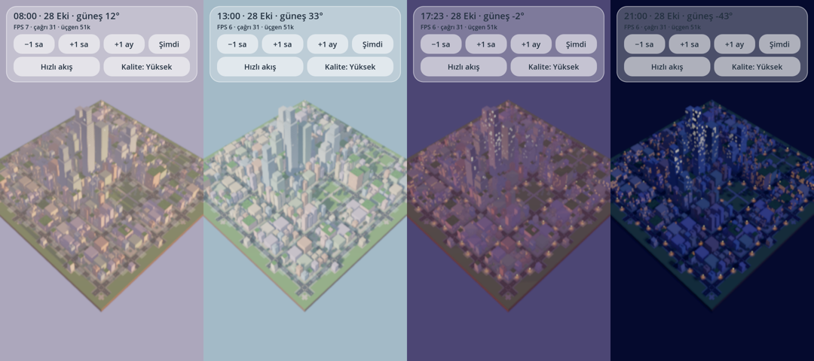
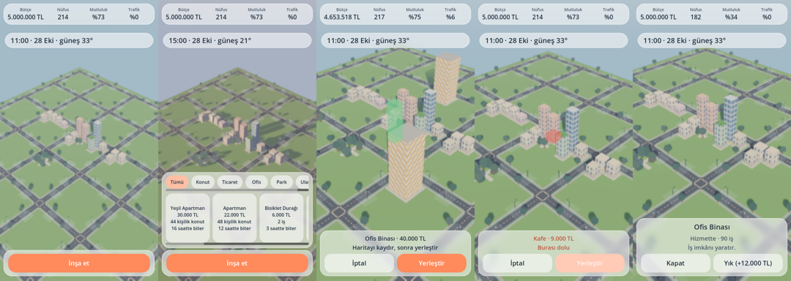
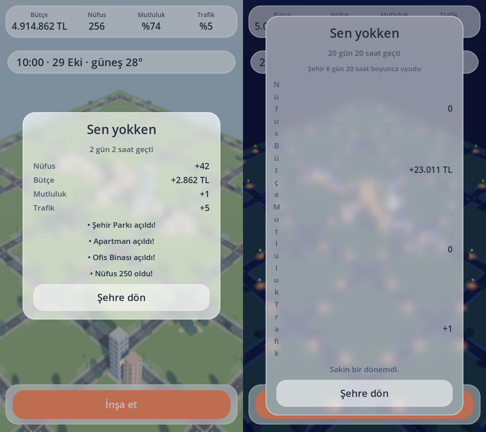
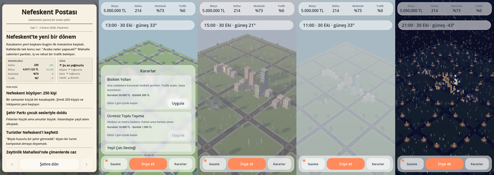
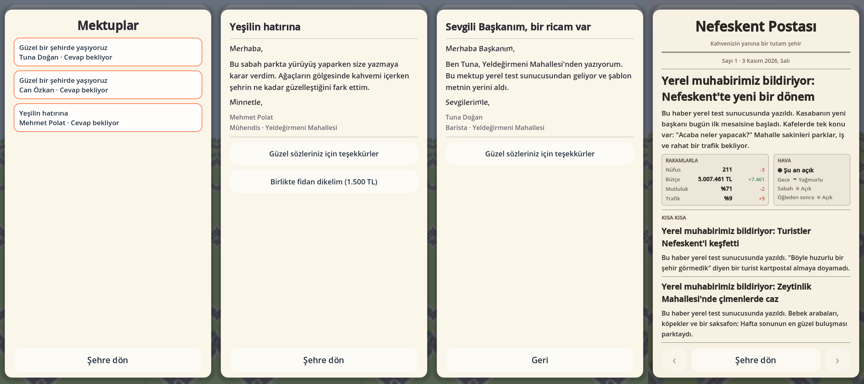
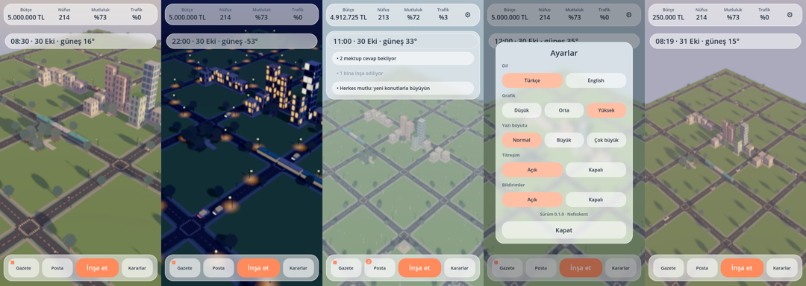

# Geliştirme Planı — Şehir Nefes Alıyor

Durum: **M0–M6 ✅ (bildirim eklentisi kararı bekleniyor). Sonraki adımlar: aşağıda "Açık işler".**
Repo başlangıçta tamamen boştu (commit yok, dosya yok).

Kalıcı kurallar için bkz. [`../CLAUDE.md`](../CLAUDE.md).

Her aşama: küçük commit'ler → aşama sonunda testler + headless çalıştırma → kısa özet.
`VARSAYIM:` etiketli maddeler onayınızı veya düzeltmenizi bekleyen kararlardır.

---

## M0 — İskelet (M1'in ilk commit'leri)

- `project.godot` (Mobile renderer, portrait, 1080×1920 taban, `canvas_items` stretch), `.gitignore`, `.gitattributes`.
- Boş klasör yapısı, autoload iskeletleri (`EventBus`, `Clock`, `Settings`).
- GUT eklentisi + ilk "duman" testi, `tools/` altında test çalıştırma script'i.
- GitHub Actions: headless Godot ile testleri çalıştıran CI.

**Kabul:** `godot --headless` ile proje hatasız açılıyor, GUT 1 test geçiyor, CI yeşil.

---

## M1 — İzometrik sahne + kamera + gün/gece döngüsü

1. `scenes/city.tscn`: zemin, ızgara (VARSAYIM: **kare ızgara, 1 hücre = 8 m, başlangıç haritası 32×32**), birkaç yer tutucu low-poly bina.
2. **Dokunmatik kamera** (`view/camera/city_camera.gd`):
   tek parmak sürükle (pan), iki parmak pinch zoom + twist döndürme, ataletli yavaşlama, sınırlar,
   editörde fare ile test (sağ tık döndür, tekerlek zoom). Pitch sabit aralıkta (35–55°).
3. **Gün/gece** (`view/environment/day_night.gd`): gerçek yerel saatten güneş açısı, gökyüzü gradyanı
   (şafak/gün/gün batımı/gece paleti `data/` içinde), ambient renk, güneş enerjisi. Sim'den bağımsız saf fonksiyon
   `SunModel.sample(local_time, day_of_year) -> SunState` (test edilebilir).
4. Pencere ışıkları (emissive maske, saate göre yanma oranı) ve sokak lambaları (MultiMesh + gece emissive).
5. Tilt-shift (DOF) + yumuşak gölge + kalite profili (low/medium/high) ilk sürümü.
6. Debug paneli: saati hızlandır/ayarla (sadece debug build), FPS/draw call göstergesi.

**Kabul:** Masaüstünde ve Android'de sahne açılıyor; kamera akıcı; debug ile saati kaydırınca gün→gece geçişi
yumuşak; `SunModel` testleri geçiyor.

---

## M2 — Bina yerleştirme + temel simülasyon

1. `sim/core`: `SimState`, `SimConfig`, `SimRng` (PCG32, tamsayı), `Simulation.step(tick)`, `SimState.hash()`.
2. `sim/content/ContentDb` + `data/buildings/*.json` (konut, kafe, ofis, park, metro istasyonu, gökdelen, çatı bahçesi...)
   ve şema doğrulama (`tools/validate_data.gd`).
3. `sim/commands`: `PlaceBuildingCommand`, `DemolishCommand` (doğrulama: yer, bütçe, yol bağlantısı).
4. Sistemler (ilk basit hâlleri): nüfus, ekonomi (gelir/gider/vergi), mutluluk, trafik yoğunluğu (bölge bazlı,
   saate göre talep eğrisi), çevre (yeşil alan/kirlilik).
5. Görsel: yerleştirme modu (hayalet bina, geçerli/geçersiz renk, büyük dokunma onayı), bina MultiMesh'leri,
   cam efektli HUD (para, nüfus, mutluluk).
6. Testler: her sistem birim testi + ilk determinizm testi.

VARSAYIM: Yol ağı ilk sürümde **otomatik** (binalar ızgara yollarına bağlanır); serbest yol çizimi M6 sonrası.

**Kabul:** Bina yerleştirilebiliyor, istatistikler tick'lerle değişiyor, sim testleri yeşil.

---

## M3 — Offline catch-up + kayıt

1. `app/Clock` (gerçek/sahte saat), `app/SimRunner` (canlı tick + catch-up, arka planda dilimlenmiş çalıştırma —
   arayüz donmasın; ilerleme göstergesi).
2. Catch-up limiti (14 gün), saat geri/ileri hile koruması.
3. `sim/save`: serialize/deserialize, `SaveMigrations`, `SaveService` (atomik yazma, yedek, bozuk kayıttan kurtarma).
   Kaydetme zamanları: uygulama arka plana geçince, her N tick'te, kritik komuttan sonra.
4. "Sen yokken" özet verisi (`CatchUpSummary`: değişen istatistikler, olay sayıları) — metni M4'te gelir.
5. **Determinizm test paketi:** tek sefer vs parçalı vs kaydet/yükle/devam; 2016 tick catch-up süresi ölçümü
   (hedef: orta telefonda < 1,5 sn).

**Kabul:** Uygulamayı kapat → sahte saatle 3 gün ileri → aç: aynı tohumla her seferinde aynı sonuç; testler yeşil.

---

## M4 — Olay motoru + gazete (şablonlu)

1. `data/events/*.json`: koşullar (mevsim, saat, gün, istatistik eşikleri, bina varlığı, önceki olay bayrakları),
   ağırlık/nadirlik, bekleme süresi (cooldown), etkiler, **zincir** (`follow_ups` + gecikme tick'i).
2. `sim/events/EventEngine`: deterministik seçim, gecikmeli sonuç kuyruğu (kararların "günler sonra" etkisi).
3. Politika/proje kararları (`data/policies`): `ChoosePolicyCommand`, gecikmeli etkiler.
4. Gazete: `EventLog` → öne çıkan olay seçimi (önem puanı) → **şablon metin** (`data/text_templates/newspaper_tr.json`,
   değişkenli, varyantlı, sıcak/esprili ton) → gazete arayüzü (manşet, 2–4 haber, hava durumu köşesi).
5. Hava durumu ve mevsim (sim tarafında deterministik hava; görselde yağmur/sis/kar parçacıkları).

**Kabul:** 7 günlük catch-up sonrası tutarlı ve tekrarlanabilir bir gazete; olay motoru testleri yeşil.

---

## M5 — Yapay zekâ backend + vatandaş mektupları

1. `sim/citizens`: kişilik özellikleri, ilgi alanları, ruh hali, **hafıza** (oyuncu kararlarına referanslar).
   VARSAYIM: Simüle edilen "adlı" vatandaş sayısı **~50–200** (geri kalan nüfus istatistiksel); mektup yazanlar bunlar.
2. Mektup tetikleyicileri (olay + kişilik + hafıza), `ReplyLetterCommand` (hazır cevap seçenekleri, sonuçlu).
3. `backend/` Cloudflare Worker (TypeScript):
   - `POST /v1/newspaper`, `POST /v1/letter` — istemci **yapılandırılmış olay verisi** yollar, serbest prompt değil.
   - Anthropic API anahtarı Worker secret'ı; model adı ortam değişkeni ile ayarlanır (varsayılan: küçük/hızlı model).
   - Anonim cihaz kimliği + hız sınırı (KV/Durable Object), yanıt önbelleği, çıktı uzunluk/içerik kontrolü.
4. `app/TextService`: backend'e zaman aşımlı istek → başarısızsa şablon; üretilen metin kayda yazılır
   (aynı gazete tekrar istenmez). **Metin sim durumunu etkilemez** → determinizm bozulmaz.
5. Testler: Worker birim testleri (sahte API), istemci tarafı yedek-metin testleri.

VARSAYIM: Oyuncunun serbest metin cevabı **yok**, sadece seçenekli cevaplar (prompt-injection ve moderasyon riski
düşük). Serbest metin istenirse ayrı karar.

**Kabul:** Backend açıkken yapay zekâ metni, kapalıyken şablon metni geliyor; anahtar istemci derlemesinde yok.

---

## M6 — Cilalama, bildirimler, performans

1. Yaşayan detaylar: araç/yaya/tramvay akışları (MultiMesh, saat ve trafik verisine göre yoğunluk), bisikletler.
2. Yerel bildirimler (eklenti; Android + iOS), sadece önemli olaylar, günde en fazla 2–3, sessiz saatler.
   Bildirimler kayıt sırasında **catch-up simülasyonu önceden koşularak** zamanlanır (sim deterministik olduğu için mümkün).
3. Oturum akışı: açılış → catch-up animasyonu → gazete → 1–2 karar → çıkış (günde 2–4 kısa oturum).
4. Performans: profil, LOD, MultiMesh birleştirme, gölge mesafesi, kalite profilinin otomatik önerisi; `docs/perf.md`.
5. UI cilası (cam paneller, geçişler, haptik), ses, erişilebilirlik (yazı boyutu), Türkçe/İngilizce dil dosyaları.
6. Android/iOS export ayarları, ikon, açılış ekranı.

**Kabul:** Hedef orta seviye cihazda 60 FPS (medium), bildirimler cihazda test edildi.

---

## Varsayımlar (onaylandı)

1. **Godot 4.4.x + Mobile renderer** — uygun mu? (4.5/4.6 kullanıyorsanız söyleyin.)
2. **Tick = 10 dakika, catch-up limiti 14 gün** — denge ve pil açısından makul buluyorum.
3. **Kare ızgara + otomatik yol ağı** (M2). Serbest yol çizimi sonraya.
4. **"Baked ışık"** yorumu: dinamik güneş zorunlu olduğundan tam lightmap yerine pişirilmiş AO + emissive pencereler.
5. **Adlı vatandaş sayısı ~50–200**, gerisi istatistiksel nüfus.
6. **Mektuplara seçenekli cevap** (serbest metin yok).
7. **3D modeller:** başlangıçta prosedürel/yer tutucu low-poly (kod/CSG/basit mesh). Kendi model kütüphaneniz veya
   tercih ettiğiniz bir CC0 paket var mı?
8. **Dil:** birincil Türkçe, İngilizce ikincil.
9. **Godot ortamda kurulu değil** — CI'da GitHub Actions indiriyor; yerelde (bulut ortamı) Godot 4.4.1 + lavapipe
   (yazılımsal Vulkan) ile gerçek Mobile renderer görüntüsü alınabiliyor (`tools/capture.gd`).
10. **Şehrin kurgusal adresi/konumu** (`data/environment/city_location.json`): "Ihlamur Sokağı No: 17, Çınaraltı
    Mahallesi, 34712 Nefeskent", enlem 40.74°. Güneşin yolu bu enleme göre, saat cihazın yerel saatine göre.
    Backend için de M5'te yer tutucu adres `https://sehir-nefes-api.example.workers.dev` (ayardan değişir).

## Aşama notları

### M1 (tamamlandı)
- Yapılan: dokunmatik kamera (pan/pinch/twist/atalet/sınırlar, fare desteği), gerçek saate bağlı güneş/ay,
  gökyüzü, sis, pencere ve sokak lambası ışıkları, tilt-shift DOF, kalite profilleri, cam efektli debug paneli
  (saat kaydırma, hızlı akış, kalite, FPS/draw call). Yer tutucu şehir tamamen MultiMesh ile (~31 draw call, ~51k üçgen).
- VARSAYIM: Saat "güneş saati" kabul edildi (boylam/yaz saati düzeltmesi yok). Düşük kalite 30 FPS sınırlı (pil).
- VARSAYIM: Ay ışığı sabit 42° yükseklikten, güneşin karşı yönünden gelir; ışık geçişi güneş −4°'deyken yapılır.
- Bilinen eksik: cihazda (Android/iOS) FPS ölçümü yapılmadı — export ayarları M6'da. Gerçek low-poly modeller yok.

### M2 (tamamlandı)
- Sim çekirdeği (`sim/`): `SimState` (serileştirilebilir, `hash()`), `Simulation.step/replay`, `SimRng` (sadece 32-bit
  tamsayı; GDScript taşma davranışına güvenmez), tamsayı takvim (`SimClockMath`), `CityGrid`, `CityAggregates` önbelleği.
- Sistemler: nüfus (konut + mutluluk hedefine yavaş yaklaşır), ekonomi (vergi/bakım, kuruş altı kalanlar dahil tam),
  trafik (blok bazlı, gün içi talep eğrisi, metro/bisiklet rahatlatması), çevre (yeşil/kirlilik), mutluluk.
- Komutlar: `PlaceBuildingCommand`, `DemolishCommand` — tick ile damgalanır, günlüğe yazılır, yeniden oynatılır.
- Olaylar: `building_placed/completed/demolished`, `day_started` (dünün özeti), `population_milestone`, `traffic_jam`.
- İçerik: 12 bina, denge ve harita JSON'da; `tools/validate_data.gd` CI'da çalışır.
- Görsel: şehir sim'den çiziliyor; inşaat iskelesi büyüyerek yükseliyor; tek elle yerleştirme (hayalet ekran
  ortasında, haritayı kaydır, "Yerleştir"), dokununca bina bilgisi ve yıkma; cam HUD ve inşa çekmecesi; TR/EN metinler.
- Determinizm: tek seferde / parçalı + JSON kaydet-yükle / komut günlüğünden yeniden oynatma → aynı hash (test ediliyor).
- Performans: 329 binalık şehirde 14 gün (2016 tick) masaüstünde ~0,5 sn (`tools/bench_sim.gd`).
- VARSAYIM: Yol ağı sabit ızgara (her 6. hücre). Bloğun iç hücreleri de yapılabilir (yola bitişiklik şartı yok).
- VARSAYIM: Binalar döndürülmüyor (hepsi kare taban). Bakım ücreti inşaat başladığı an işler.
- VARSAYIM: Yıkımda maliyetin %30'u iade. Bütçe eksiye düşebilir (borç); yeni inşaat için para gerekir.
- VARSAYIM: Saat dilimi şehir kurulurken sabitlenir. Dil varsayılanı cihazdan bağımsız Türkçe.
- VARSAYIM: Kayıt M3'e kadar yok — her açılışta yeni kasaba kurulur.
- M3'e not: `CityAggregates` her bina tamamlanışında yeniden hesaplanıyor (mutluluk yarıçapı O(n²)); catch-up hedefi
  için ölçülecek, gerekirse artımlı yapılacak.

### M3 (tamamlandı)
- Kayıt: `SaveCodec` (saf) + `SaveMigrations` zinciri (`CURRENT = 1`), dosyada `state_hash` ile bozulma tespiti.
  `SaveService`: `.tmp` yaz → doğrula → `city.json`→`.bak`, `.tmp`→`city.json`; ana dosya bozuksa yedekten açılır
  (oyuncuya "Kayıt yedekten kurtarıldı" bildirimi). Sabit `tests/fixtures/saves/v1_city.json` + göç testleri.
- Kayıt anları: her saat (6 tick), her başarılı komuttan sonra, uygulama arka plana geçince/kapanırken, catch-up bitince.
- Catch-up: açılışta ve uygulama geri gelince `CatchUp.plan` → (gerekirse) `RealignClockCommand` → şehrin kopyası
  üzerinde **arka plan thread'inde** `CatchUpJob` → ana thread'de değiştir → kaydet → "Sen yokken" kartı.
  ≤ 6 tick'lik açıklar canlı adımlanır. Catch-up sürerken komutlar reddedilir (`ERR_CITY_BUSY`).
- 14 gün sınırı: fazlası "uyku" — takvim çapası kaydırılır, simüle edilmez; en son 14 gün simüle edilir, sim saati
  her zaman duvar saatine eşit kalır.
- Saat geri alınırsa: ≤ 6 saat → şehir bekler (geri sarılmaz). VARSAYIM: > 6 saat → şehir durumu korunur, takvim
  çapası yeni saate kaydırılır (`clock_rebased` olayı); aksi hâlde saat bir yıl geri alınınca şehir bir yıl donardı.
- Determinizm: `tools/verify_save.gd` bir kaydı tohum + komut günlüğünden baştan oynatıp hash'i karşılaştırır
  (CI'da fixture üzerinde çalışır). Testler: thread'li catch-up = doğrudan adımlama; uyku/rebase içeren yeniden oynatma.
- Testler/araçlar gerçek kayda dokunmaz: `SEHIR_SAVE_DIR` (run_tests.sh otomatik ayarlar), capture aracı kendi klasörü.
- VARSAYIM: Aynı anda tek şehir (tek kayıt yuvası). Bulut kaydı yok.
- Bilinen eksik: catch-up ilerleme kartı çok kısa sürdüğü için masaüstünde ancak bir an görünüyor; telefonda ölçülecek (M6).

### M4 (tamamlandı)
- Kayıt v2: hava, bayraklar, bekleme süreleri, bekleyen takip olayları, geçici değiştiriciler, politikalar.
  v1→v2 göçü; hash artık göçten önce ham veride doğrulanıyor (eski sürümler de korunuyor). v1 ve v2 fixture'ları.
- Hava: 6 saatlik dilimler, mevsimsel olasılık + süreklilik, kusursuz tahmin; etkileri trafik/mutluluğa yansır.
  Görselde yağmur/kar parçacıkları, pus, kararma, fırtınada şimşek (kalite profiline bağlı yoğunluk).
- Olay motoru (`sim/events/EventEngine`): 20 olay, koşullar (mevsim, hava, saat, gün, istatistik, bina, bayrak, karar),
  ağırlık, bekleme, etkiler (değiştirici, para, bayrak), zincir (gecikmeli takip olayı). 14 günde ~10–13 hikâye.
- Kararlar: 6 politika (`ChoosePolicyCommand`), kurulum + günlük maliyet, gecikmeli etki ("3 günde etkili olur").
- Gazete: `NewsDesk` (önem puanı, birleştirme, dolgu) → `TemplateWriter` (TR/EN, deterministik varyant) →
  `TextService` (yokluktan sonra ve her sabah baskı; arşiv kaydın `meta` alanında, 10 sayı). Gazete ekranı, HUD'da
  okunmamış işareti, canlı oyunda hikâye başlığı bildirimi. Format: [`events.md`](events.md).
- **Motor hatası bulundu ve kalıcı kurala bağlandı:** Godot 4.4.1'de tick başına çalışan statik koddan `const` tipli
  diziyi dolaşmak yığını bozuyor (rastgele "double free"). `sim/` içinde bu kalıp yasak; `test_sim_code_rules.gd` denetler.
- Testler artık `SimRunner`'ın açılış catch-up thread'iyle yarışmıyor (`SEHIR_TEST=1`).
- VARSAYIM: Hava tahmini hep doğru. Canlı oyunda gazete her gün başında (yerel 00:00) basılır; okunmamış işaretiyle
  bekler, kendiliğinden açılmaz. Gece yarısı uygulama açıksa bile oyuncuyu bölmez.
- VARSAYIM: Mektuplar ve vatandaşlar M5'te; gazetedeki alıntılar şimdilik şablon içi anonim seslerdir.
- Performans: dolu şehirde 14 gün ~0,7 sn (0,35 ms/tick; thread'de).

### M5 (tamamlandı)
- Vatandaşlar (`sim/citizens`): 11 arketip, Türkçe ad havuzu, kişilik (civic/eco/thrift/social/patience), ilgi alanları,
  ev mahallesi, ilgi alanına göre değişen ruh hali, kararları hatırlayan sınırlı hafıza (`data/citizens/memory_rules.json`).
  Nüfusun ~1/10'u, 6–120 kişi; gece yarısı yeni gelenler eklenir, kimse silinmez.
- Mektuplar: 13 konu (`letter_topics.json`) — koşul + ilgi + ruh hali kimin ne yazacağını belirler; günde en fazla bir
  mektup, en fazla 4 açık mektup, 72 saatte cevapsız kalırsa küser ve hatırlar. `ReplyLetterCommand` hazır seçeneklerle
  (etki + ruh hali + hafıza). Kayıt v3 + göç + fixture.
- Metin: `LetterWriter` (yaşa göre resmî/samimi hitap, hafıza cümlesi, meslekli imza), TR/EN şablonlar; Posta ekranı,
  HUD'da açık mektup sayacı, canlı oyunda "Yeni mektup" bildirimi.
- Backend (`backend/`, Cloudflare Worker, TypeScript): `/v1/newspaper`, `/v1/letter`. İstemci sadece yapılandırılmış veri
  yollar (oyuncu serbest metin yazmaz); zod ile sıkı doğrulama; Anthropic SDK, model ortam değişkeninden
  (varsayılan `claude-opus-5-5`), `effort: low`, JSON şemalı çıktı, önbelleklenen sabit sistem istemi, `fallbacks: "default"`;
  çıktı tekrar doğrulanır (uzunluk, bağlantı/işaret yok). Cihaz başına günlük sınır + yanıt önbelleği (KV).
- İstemci: `TextService` kuyruğu (tek istek, zaman aşımı), metin dil bazında kaydın `meta` alanında; her hata → şablon.
  Godot ↔ TS sözleşmesi: oyunun gerçek istek gövdeleri `backend/test/fixtures`'ta, vitest doğrular.
- Doğrulama: 194 Godot testi (sahte HTTP sunucusuyla başarı/502/zaman aşımı/bozuk yanıt), 16 backend testi;
  gerçek Worker kodu + sahte model ile uçtan uca ekran görüntüsü.
- Bulunan hata: gazete "tr:1" ile mektup "tr:1" aynı yeniden-deneme anahtarını paylaşıyordu (regresyon testi var).
- VARSAYIM: Backend adresi yer tutucu ve kapalı (`data/config/backend.json`); yayına alınınca açılır.
  Mektuplara serbest metin cevap yok. Vatandaşların cinsiyeti tutulmuyor (Türkçe zamir ayrımı yok, ad listesi karışık).
- VARSAYIM: Göç edilmiş kayıtlar (v1/v2) baştan oynatılamaz; göçten sonra deterministik devam ederler.
- **Sizin yapmanız gerekenler:** Cloudflare hesabı + `wrangler kv namespace create` ×2 + `wrangler secret put
  ANTHROPIC_API_KEY` + `wrangler deploy`; sonra Worker adresini `backend.json`'a yazıp `enabled: true`. Ayrıntı: `backend/README.md`.

### M6 (tamamlandı — bildirim eklentisi hariç)
- Sokak hayatı (`view/life`): arabalar (gece farlar), yayalar, merkez caddede raylı tramvay. MultiMesh + önceden ayrılmış
  tampon; sayılar nüfus × saat × hava (`data/environment/life.json`); konumlar zamanın saf fonksiyonu (`LifeMath`).
- Ayarlar: dil (TR/EN, arayüz yeniden kurulur), grafik, yazı boyutu (tüm arayüz katmanı ölçeklenir; büyükte alt çubuk iki
  satır), titreşim, bildirimler. Test/araç ayarları da `SEHIR_SAVE_DIR`'da, gerçek ayarlara dokunmaz.
- Oturum akışı: açılış → yetiştirme → gazete → **Bugünün gündemi** (cevap bekleyen mektuplar, yürürlüğe girecek kararlar,
  inşaatlar, en zayıf alana tek öneri; dokununca ilgili ekran) → 1–2 karar. Panellerde yumuşak geçiş, onaylarda titreşim.
- Bildirimler: `NotificationPlanner` arka plana geçerken şehrin kopyasını 24 saat ileri koşturur, önemli anları seçer
  (günde ≤3, ≥3 saat ara, 22:00–08:00 sessiz → sabaha kayar; `data/config/notifications.json`). `LocalNotifier` şimdilik
  sadece kaydeder; **gerçek Android/iOS teslimi eklenti kararını bekliyor.**
- Performans: dolu şehirde 96 draw call / 210k üçgen (bütçe 150 / 300k). İlk oturumda FPS < 45 ise kalite bir kademe düşer
  (bir kez). Uzakta yaya/araç gizlenir. Ölçüm aracı `tools/perf_probe.gd`, sonuçlar `docs/perf.md`.
- Export: uygulama simgesi (+ Android uyarlanabilir katmanlar), açılış ekranı, `export_presets.cfg` (Android arm64 API 24+,
  iOS 15, Linux). Dışa aktarılan paket incelendi: veri dahil; test/araç/backend/GUT hariç. Dışa aktarılmış Linux sürümü gerçek
  render ile çalıştırıldı.
- CI `export` işi: soğuk açılış duman testi (editör + dışa aktarılmış oyun), Android **debug APK** artefaktı (runner'ın SDK'sı).
- Bulunan hatalar: yeni şehir ilk otomatik kayda kadar diske yazılmıyordu; soğuk açılışta ilk gazete hiç basılmıyordu
  (autoload sırası). İkisi de düzeltildi; `tools/startup_smoke.sh` bunları yakalar.
- VARSAYIM: Paket adı `com.nefeskent.sehirnefesaliyor`. Ses yok (ses varlığı yok). Sadece arm64 Android.

## Açık işler (karar/erişim gerektirenler)
1. **Bildirim eklentisi** (CLAUDE.md: yeni 3. taraf bağımlılık → onay): hazır bir Godot 4.4 yerel bildirim eklentisi mi,
   yoksa kendi küçük Android (Kotlin) + iOS (Swift) eklentimiz mi? `LocalNotifier`'a alt sınıf olarak takılır.
2. **Backend yayını**: Cloudflare hesabı + `ANTHROPIC_API_KEY` (bkz. `backend/README.md`), sonra `data/config/backend.json`.
3. **Mağaza imzası**: release keystore (Android) ve Apple geliştirici hesabı/Team ID (iOS; derleme macOS gerektirir).
4. Gerçek low-poly model seti ve ses (şu an prosedürel yer tutucular).
5. Cihazda FPS ölçümü (orta seviye Android) → `docs/perf.md`.
